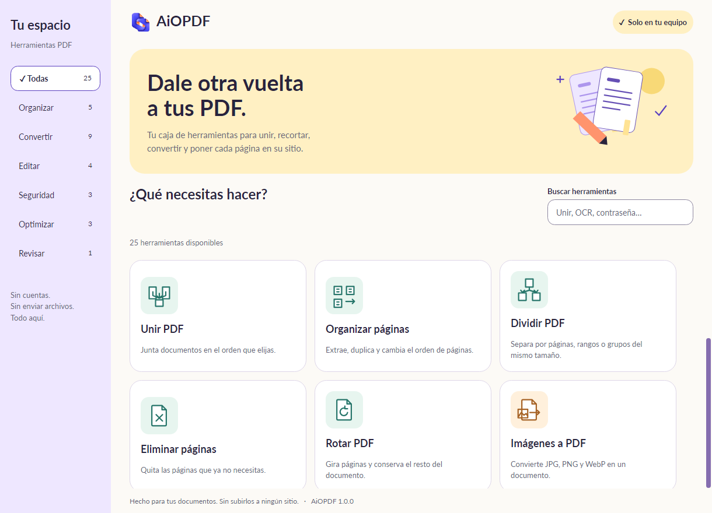

<div align="center">
  
  <h1>AiOPDF</h1>
  <p><strong>Tus PDF. En tu equipo.</strong></p>
  <p>Una caja de herramientas de escritorio para procesar documentos localmente.</p>

[](LICENSE)
[](CHANGELOG.md)
[](https://github.com/TastingRogue/AiOPDF/actions/workflows/validate.yml)
[](docs/LOCALIZATION.md)

**[Descargar para Windows, macOS y Linux](https://github.com/TastingRogue/AiOPDF/releases/tag/v1.0.0-rc.3)** · **[English](README.md)** · **[Manual de uso](docs/USER_MANUAL.es.md)**
</div>

AiOPDF reúne 25 herramientas PDF en un flujo sencillo: elige una herramienta, añade archivos locales, revisa el resultado y guarda una copia donde quieras. No necesita cuenta, envío de documentos, navegador ni servicio por localhost. Las bibliotecas nativas y los modelos OCR de alfabeto latino vienen incluidos en la aplicación.

> [!IMPORTANT]
> **1.0.0-rc.3 es una candidata, no la versión 1.0 estable.** Siguen pendientes la firma Windows, Developer ID/notarización macOS y la aceptación humana de accesibilidad y compatibilidad ampliada. La evidencia de instalación se registra en la [guía de instaladores](docs/INSTALLERS.md). Consulta el [checklist de lanzamiento](docs/RELEASE-CHECKLIST.md).

**Para usarla:** [Capturas](#capturas) · [Funciones](#funciones) · [Instalación](#instalación) · [Privacidad](#privacidad-y-guardado) · [Límites](#límites-actuales)

**[Code signing policy](docs/CODE-SIGNING-POLICY.md)** · [Signing setup / Alta de firmas](docs/SIGNING-SETUP.md) · [Privacy / Privacidad](docs/PRIVACY.md)

**Para contribuir:** [Desarrollo](#desarrollo) · [Guía de contribución](CONTRIBUTING.md) · [Añadir idiomas](docs/LOCALIZATION.md) · [Roadmap](ROADMAP.md) · [Seguridad](.github/SECURITY.md)

## Capturas

Las capturas muestran documentos sintéticos o espacios vacíos. No incluyen documentos privados de usuarios.

### Herramientas fáciles de encontrar

Busca una función o explora las categorías. Cambia entre español e inglés desde la cabecera.



### Comparar y revisar antes de guardar

Lee páginas completas en paralelo, navega por el texto añadido y eliminado y guarda un informe si lo necesitas.


<table>
  <tr>
    <td width="50%"></td>
    <td width="50%"></td>
  </tr>
</table>

Algunas capturas corresponden a candidatas anteriores. Más ejemplos en [docs/screenshots](docs/screenshots).

## Funciones

| Categoría | Herramientas |
| --- | --- |
| Organizar | Unir, organizar/extraer/duplicar, dividir, eliminar páginas y rotar |
| Convertir | Imágenes a PDF, PDF a PNG/JPG, extraer texto, OCR a PDF/texto, texto a Word/Excel y páginas a diapositivas |
| Editar | Marca de agua, numeración, recorte y metadatos |
| Seguridad | Protección AES-256, quitar una contraseña conocida y censurar una región |
| Optimizar | Rasterizar, compresión sin pérdida y escala de grises |
| Revisar | Comparar contenido con subrayados por página e informes TXT/JSON opcionales |

Incluye arrastrar archivos, miniaturas, progreso, cancelación y reutilización del resultado revisado. Los idiomas son módulos JSON: [añadir una traducción](docs/LOCALIZATION.md) no requiere cambiar el motor PDF.

## Instalación

### Windows x64

1. Abre la [release 1.0.0-rc.3](https://github.com/TastingRogue/AiOPDF/releases/tag/v1.0.0-rc.3).
2. Descarga `AiOPDF-1.0.0-rc.3-windows-x64-setup.exe` e instálalo para tu usuario.
3. Abre AiOPDF, elige una herramienta y añade archivos.

La aplicación instalada no necesita SDK .NET. El instalador candidato no está firmado; verifica la descarga con el manifiesto SHA-256 adjunto a la release. El hash comprueba la integridad del archivo, no la identidad del editor.

### macOS y Linux

La candidata incluye un DMG para Mac Apple Silicon y un DEB para Ubuntu 24.04 amd64. Copia AiOPDF.app a Applications desde el DMG, o instala el DEB con `sudo apt install ./AiOPDF-1.0.0-rc.3-linux-amd64.deb`. El DMG tiene firma ad-hoc y no está notarizado; macOS puede bloquear su apertura. Las pruebas nativas de CI cubren macOS 15 arm64 y Ubuntu 24.04 amd64. Siguen pendientes Mac Intel, Linux ARM, otras versiones de sistema y la aceptación humana de accesibilidad. Consulta la [evidencia y requisitos de firma](docs/INSTALLERS.md).

Consulta el [manual](docs/USER_MANUAL.es.md) y el [checklist de lanzamiento](docs/RELEASE-CHECKLIST.md).

## Privacidad y guardado

- El procesamiento ocurre en tu equipo, sin subir documentos ni iniciar un servidor web local.
- La acción prepara un resultado temporal. **Guardar copia** permite elegir el destino final.
- Los archivos existentes no se sobrescriben: elige un nombre nuevo para el resultado.
- Los temporales se eliminan al cerrar normalmente. Las sesiones abandonadas se recuperan al volver a iniciar, sin borrar otra sesión activa.
- Las copias exportadas permanecen en el destino elegido hasta que tú las elimines.

Procesar localmente no vuelve seguro un PDF ni elimina automáticamente sus datos sensibles. Revisa el resultado antes de compartirlo. Consulta la [política de seguridad](.github/SECURITY.md).

## Límites actuales

| Herramienta | Comportamiento actual |
| --- | --- |
| Compresión | Optimiza sin pérdida; si no reduce el tamaño, guarda una copia idéntica y lo indica. |
| Recorte | Oculta márgenes; no elimina su contenido. Usa censura para eliminar una región. |
| Rasterizar / grises / censurar | Las páginas seleccionadas pasan a imágenes y pierden texto seleccionable, formularios y enlaces. Las demás se conservan. |
| OCR | Usa modelos locales de alfabeto latino. Revisa el texto reconocido. El PDF buscable incluye páginas rasterizadas y una capa de texto invisible. |
| Comparación | Compara palabras por número de página e ignora espacios y saltos de línea. No compara imágenes, significado ni alinea páginas movidas. Las páginas sin texto extraíble requieren OCR. |
| Exportación Office | Word contiene texto, Excel una línea por fila y las diapositivas imágenes de páginas. No reconstruye tablas ni el diseño original. |

Office a PDF, firmas digitales, PDF/A, reparación y edición avanzada de formularios quedan para versiones posteriores. No se afirma paridad con iLovePDF o Stirling-PDF; no se incorporó código de esos proyectos.

## Desarrollo

Instala el SDK indicado en [global.json](global.json) y ejecuta desde la raíz:

```sh
git clone https://github.com/TastingRogue/AiOPDF.git
cd AiOPDF
dotnet restore tests/AiOPDF.Checks --locked-mode
dotnet build tests/AiOPDF.Checks -c Release --no-restore -warnaserror
dotnet run --project src/AiOPDF
```

```sh
dotnet run --project tests/AiOPDF.Checks -c Release -- --localization
dotnet run --project tests/AiOPDF.Checks -c Release -- --improvements-en
```

La [guía de contribución](CONTRIBUTING.md) incluye requisitos nativos, matriz de pruebas, estructura y empaquetado. La carpeta local `.tools` no forma parte del repositorio.

| Componente | Tecnología |
| --- | --- |
| Aplicación | C# / .NET 10 / Avalonia |
| Operaciones PDF | PDFsharp, PdfPig, PDFium / PDFtoImage |
| Imágenes | Skia |
| OCR sin conexión | RapidOcrNet / ONNX Runtime |
| Exportaciones Office | Open XML SDK |
| Validación | Pruebas del motor y de interfaz con Avalonia Headless |

## Apoyar y contribuir

[Reporta un problema](https://github.com/TastingRogue/AiOPDF/issues/new/choose), propone una función o mejora una traducción. Incluye pasos claros y archivos sintéticos. Lee la [guía de contribución](CONTRIBUTING.md) y el [código de conducta](.github/CODE_OF_CONDUCT.md).

También puedes dar una estrella al repositorio o apoyar a [TastingRogue en GitHub Sponsors](https://github.com/sponsors/TastingRogue), el mismo creador de [HomeLedger](https://github.com/TastingRogue/HomeLedger).

## Licencia

Código bajo [MIT](LICENSE). Bibliotecas, modelos OCR, fuentes y recursos conservan sus licencias aplicables; revisa los [avisos de terceros](docs/THIRD-PARTY-NOTICES.md) y la [procedencia de los recursos](docs/ASSETS.md).

