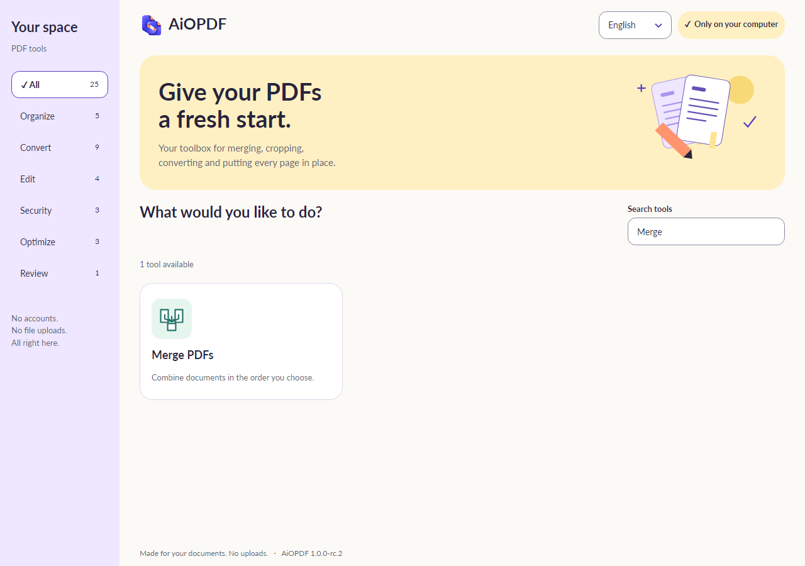
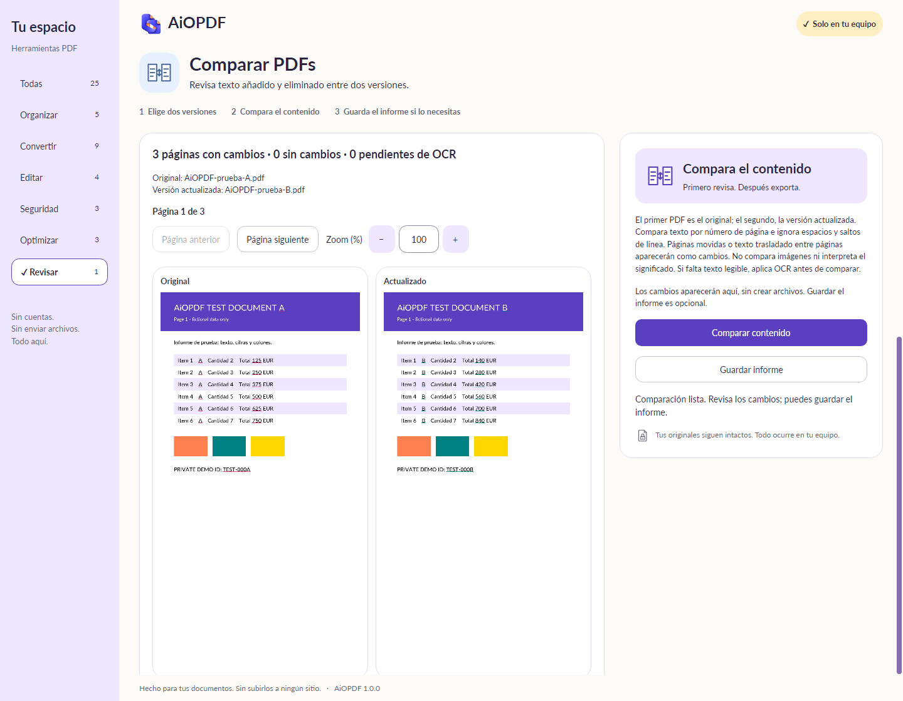
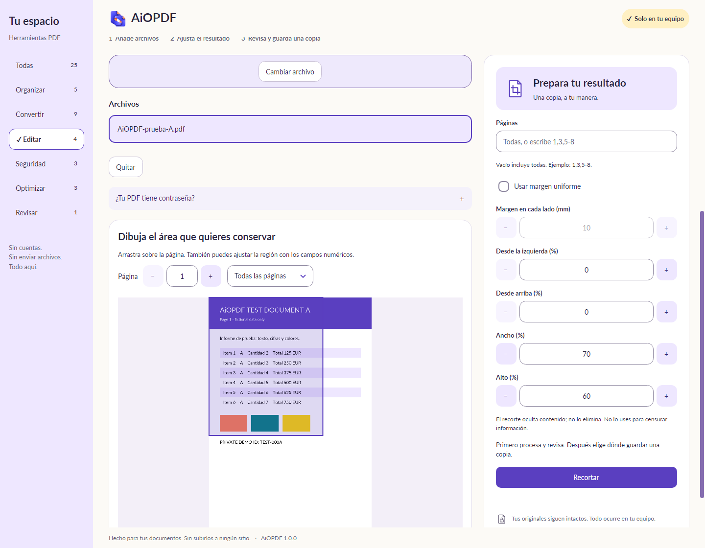
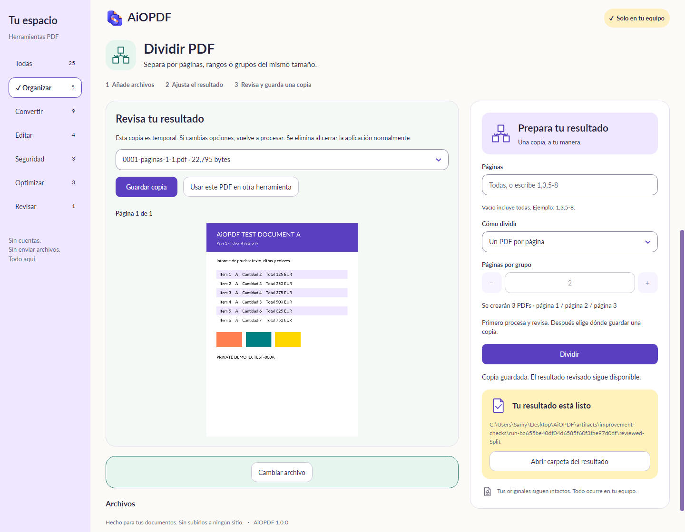

<div align="center">
  
  <h1>AiOPDF</h1>
  <p><strong>Your PDFs. Your computer.</strong></p>
  <p>A desktop PDF toolbox that keeps document processing local.</p>

[](LICENSE)
[](CHANGELOG.md)
[](https://github.com/TastingRogue/AiOPDF/actions/workflows/validate.yml)
[](docs/LOCALIZATION.md)
[](https://github.com/sponsors/TastingRogue)

**[Download for Windows, macOS and Linux](https://github.com/TastingRogue/AiOPDF/releases/tag/v1.0.0-rc.3)** · **[Read in Spanish](README.es.md)** · **[User guide](docs/USER_MANUAL.md)**
</div>

AiOPDF combines 25 PDF tools with a simple workflow: choose a tool, add local files, review the result and save a copy where you want. No account, document upload, browser or localhost service is required. The native libraries and Latin-alphabet OCR models are included in the desktop package.

> [!IMPORTANT]
> **1.0.0-rc.3 is a release candidate, not a stable 1.0 release.** Windows signing, macOS Developer ID/notarization, human accessibility and broader compatibility acceptance remain open. Installer lifecycle evidence is tracked in the [installer guide](docs/INSTALLERS.md). See the [release checklist](docs/RELEASE-CHECKLIST.md).

**Using AiOPDF:** [Screenshots](#screenshots) · [Features](#features) · [Installation](#installation) · [Privacy](#privacy-and-saving) · [Limitations](#know-the-limits)

**[Code signing policy](docs/CODE-SIGNING-POLICY.md)** · [Signing setup](docs/SIGNING-SETUP.md) · [Privacy policy](docs/PRIVACY.md)

**Contributing:** [Development](#development) · [Contribution guide](CONTRIBUTING.md) · [Add a language](docs/LOCALIZATION.md) · [Roadmap](ROADMAP.md) · [Security](.github/SECURITY.md)

## Screenshots

Screenshots show the application with synthetic documents or empty workspaces. No private user documents are included.

### A toolbox you can browse

Search for a tool or explore the categories. Switch between Spanish and English from the header.



### Review content changes

Compare two versions, read complete pages side by side and navigate added or removed text. Saving a report is optional.



<table>
  <tr>
    <td width="50%"></td>
    <td width="50%"></td>
  </tr>
</table>

Some captures show earlier candidate builds. More examples are in [docs/screenshots](docs/screenshots).

## Features

| Category | Tools |
| --- | --- |
| Organize | Merge, organize/extract/duplicate pages, split, remove pages, rotate |
| Convert | Images to PDF, PDF to PNG/JPG, extract text, OCR to PDF/text, text to Word/Excel, pages to slides |
| Edit | Watermark, page numbers, crop, metadata |
| Security | AES-256 protection, remove a known password, redact a region |
| Optimize | Rasterize, lossless compression, grayscale |
| Review | Compare text with page-level underlines and optional TXT/JSON reports |

Also includes drag-and-drop input, previews, progress, cancellation and a reusable reviewed result. Translation modules are JSON files; [adding a language](docs/LOCALIZATION.md) does not require changing the PDF engine.

## Installation

### Windows x64

1. Open the [1.0.0-rc.3 release](https://github.com/TastingRogue/AiOPDF/releases/tag/v1.0.0-rc.3).
2. Download `AiOPDF-1.0.0-rc.3-windows-x64-setup.exe` and install it for your user.
3. Open AiOPDF, choose a tool and add files.

The installed application does not require the .NET SDK. The candidate installer is unsigned; use SHA256SUMS.txt attached to the release to verify the download. A matching hash confirms file integrity, not publisher identity.

### macOS and Linux

The candidate release includes a DMG for Apple Silicon Macs and a DEB for Ubuntu 24.04 amd64. Copy AiOPDF.app to Applications from the DMG, or install the DEB with `sudo apt install ./AiOPDF-1.0.0-rc.3-linux-amd64.deb`. The DMG is ad-hoc signed and is not notarized; macOS may block opening it. Native CI tests cover macOS 15 arm64 and Ubuntu 24.04 amd64. Intel Mac, ARM Linux, other OS versions and human accessibility acceptance remain open. See the [installer evidence and signing requirements](docs/INSTALLERS.md).

See the [user guide](docs/USER_MANUAL.md) and [release checklist](docs/RELEASE-CHECKLIST.md).

## Privacy and saving

- Processing happens on your computer. No document-upload workflow or local web server is used.
- The action prepares a temporary result for review. **Save copy** asks for the final location.
- Existing destination files are preserved; choose a new name for the result.
- Review temporaries are removed on normal close. Abandoned sessions are recovered on the next launch without deleting another active session.
- Exported results remain in the location you selected until you remove them yourself.

Local processing does not make an input PDF safe or remove sensitive information automatically. Review output before sharing it. See [security reporting](.github/SECURITY.md).

## Know the limits

| Tool | Current behavior |
| --- | --- |
| Compression | Lossless optimization. If it cannot reduce size, saves an identical copy and tells you. |
| Crop | Hides margins; does not remove their content. Use redaction to remove a region. |
| Rasterize / grayscale / redact | Selected pages become images and lose selectable text, forms and links. Other pages are preserved. |
| OCR | Included Latin-alphabet models; recognized text needs review. Searchable PDF pages are rasterized with a hidden text layer. |
| Comparison | Compares words by page number, ignoring spaces and line breaks. Does not compare images, meaning or align moved pages. Pages without extractable text require OCR. |
| Office exports | Word exports text, Excel exports a line per row, slides contain page images. No reconstruction of tables or original layout. |

Office-to-PDF, digital signatures, PDF/A, repair and advanced form editing are future work. AiOPDF does not claim feature parity with iLovePDF or Stirling-PDF. The interface and processing implementation are original; code from those projects is not included.

## Development

Install the .NET SDK specified in [global.json](global.json), then run these commands from the repository root:

```sh
git clone https://github.com/TastingRogue/AiOPDF.git
cd AiOPDF
dotnet restore tests/AiOPDF.Checks --locked-mode
dotnet build tests/AiOPDF.Checks -c Release --no-restore -warnaserror
dotnet run --project src/AiOPDF
```

```sh
dotnet run --project tests/AiOPDF.Checks -c Release -- --localization
dotnet run --project tests/AiOPDF.Checks -c Release -- --improvements-en
```

See [CONTRIBUTING.md](CONTRIBUTING.md) for the full check matrix, native prerequisites and packaging commands. A developer's local `.tools` directory is not included in this repository.

| Component | Technology |
| --- | --- |
| Application | C# / .NET 10 / Avalonia |
| PDF operations | PDFsharp, PdfPig, PDFium / PDFtoImage |
| Images | Skia |
| Offline OCR | RapidOcrNet / ONNX Runtime |
| Office output | Open XML SDK |
| Validation | Native engine checks and Avalonia Headless UI checks |

```text
src/AiOPDF/           Application, PDF tools, original assets and language modules
tests/AiOPDF.Checks/  Synthetic documents and regression checks
packaging/           Windows, macOS and Linux package definitions
scripts/             Publishing, packaging and optional signing
docs/                User guide, audits, validation, licenses and screenshots
.github/             CI, contribution templates and community policies
```

## Support and contribute

[Report a bug](https://github.com/TastingRogue/AiOPDF/issues/new/choose), suggest a feature or improve a translation. Small changes with clear reproduction steps and synthetic files are especially useful. Read the [contribution guide](CONTRIBUTING.md) and [code of conduct](.github/CODE_OF_CONDUCT.md).

You can also star the repository or support [TastingRogue on GitHub Sponsors](https://github.com/sponsors/TastingRogue), the same maintainer behind [HomeLedger](https://github.com/TastingRogue/HomeLedger).

## License

AiOPDF code is licensed under [MIT](LICENSE). Dependencies, OCR models, fonts and artwork retain their own applicable licenses; see [third-party notices](docs/THIRD-PARTY-NOTICES.md) and [asset provenance](docs/ASSETS.md).
